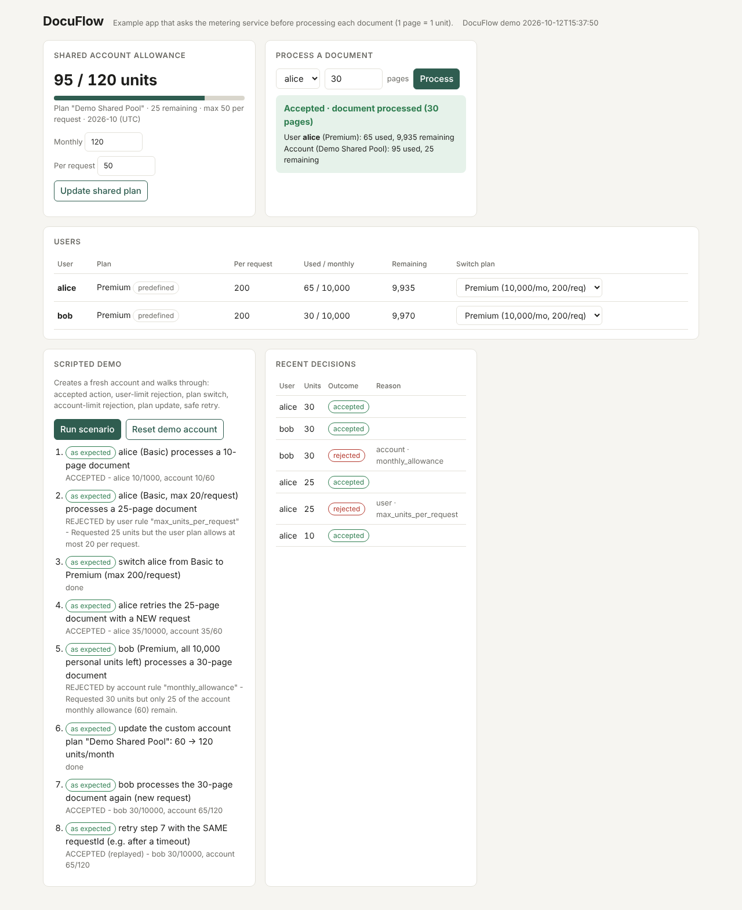

# Usage Metering and Quota Service

This is a backend service that other applications call before letting one of their users do
something that costs units. It answers one question - *"can this user consume N units right now?"* -
by checking the account's shared plan and the user's own plan together. Every decision is recorded,
and usage is only counted when the request is accepted.

- TypeScript (Node 22, Express 5), PostgreSQL 16 with plain SQL through `pg`, zod for input validation.
- One service and one database. I didn't add Redis or a queue: row locks, one transaction per decision
  and a unique request id were enough to keep the totals exact (see the concurrency and performance sections).
- One resource, "document processing credits". The example app treats 1 page as 1 unit.

---

## Contents

1. [Quick start](#1-quick-start)
2. [Repository layout](#2-repository-layout)
3. [Accounts, users, plans and API keys](#3-accounts-users-plans-and-api-keys)
4. [API reference](#4-api-reference)
5. [How a decision is made](#5-how-a-decision-is-made)
6. [Plan changes](#6-plan-changes)
7. [Retries and idempotency](#7-retries-and-idempotency)
8. [Concurrency design](#8-concurrency-design)
9. [Database schema](#9-database-schema)
10. [Product assumptions](#10-product-assumptions)
11. [Design decisions and trade-offs](#11-design-decisions-and-trade-offs)
12. [Tests](#12-tests)
13. [Performance](#13-performance)
14. [Known limitations](#14-known-limitations)
15. [Running without Docker](#15-running-without-docker)

---

## 1. Quick start

Requirements: Docker with Compose v2.

```bash
docker compose up --build
```

This starts three containers:

| container | URL | what it is |
|---|---|---|
| `db` | `localhost:5432` (user/pass/db: `metering`) | PostgreSQL 16 with a named volume (`pgdata`) - data survives restarts |
| `metering` | http://localhost:3000 | the metering service. On startup it waits for the DB, applies SQL migrations and creates the predefined plans |
| `client` | **http://localhost:8080** | **DocuFlow**, the example application (web UI) |

Open **http://localhost:8080** and press **Run scenario**. It creates a fresh account and shows, step by step:
an accepted action, a rejection by a **user** limit, a plan switch that changes what the user can do (same client code),
a rejection by the **shared account** limit, a custom plan update, and a safe retry that is not counted twice.
You can also process documents manually, switch user plans from the table, and edit the shared account plan.



The same scenario on the command line (exit code 0 = every step behaved as expected):

```bash
docker compose exec client node dist/cli.js
```

Configuration (environment variables, all have working defaults in `docker-compose.yml`):

| variable | used by | default | meaning |
|---|---|---|---|
| `ADMIN_API_KEY` | service, client, perf | `change-me-admin-key` | secret for `POST /v1/accounts`. Override: `ADMIN_API_KEY=... docker compose up --build` |
| `DATABASE_URL` | service | `postgres://metering:metering@db:5432/metering` | PostgreSQL connection |
| `PORT` | service / client | `3000` / `8080` | HTTP port |
| `DB_POOL_MAX` | service | `20` | DB connection pool size (chosen from the load tests) |
| `METERING_URL` | client, perf | `http://metering:3000` | where the service is |

Optional profiles:

```bash
docker compose --profile test run --rm tests   # automated tests against the real Postgres
docker compose --profile perf run --rm perf    # load-test suite against the running stack
```

---

## 2. Repository layout

```
service/                 the metering service
  migrations/001_initial_schema.sql   whole schema (constraints do part of the validation)
  src/
    server.ts            startup: config -> wait for DB -> migrate -> seed predefined plans -> listen
    config.ts            environment variables
    deps.ts              injected dependencies (pool, clock, admin key) -> testable
    db/                  pool + transaction helper, migration runner, predefined-plan seeding
    domain/              PURE logic, no I/O: rules.ts (rule engine), period.ts (UTC months),
                         apiKey.ts (generation/hashing), predefinedPlans.ts
    services/            accounting + persistence: consume.ts (the core), plans, users,
                         accounts, usage, requests (history), decisions (formatting)
    http/                app.ts (Express wiring), auth.ts, validation.ts (zod), errors.ts
    routes/              thin HTTP handlers: validate -> call a service -> send JSON
  test/                  vitest + supertest against a real PostgreSQL
client/                  DocuFlow example app: web UI (public/index.html) + CLI demo (src/cli.ts)
perf/                    load-test tool, suite script, RESULTS.md, raw results
docker-compose.yml
docs/client-screenshot.png
```

---

## 3. Accounts, users, plans and API keys

| concept | in this service |
|---|---|
| **Account** | An application/company. Created by an operator with the admin key; gets **one API key**. Has exactly one **account plan** (shared limits). |
| **User** | A user of that application, registered under one account with the application's own id (e.g. `"alice"`). Has exactly one **user plan** (individual limits). The same id can exist in two accounts - they are different users. |
| **Plan** | A named set of rules with a `scope` (`account` or `user`). **Predefined** plans exist from startup and are read-only; **custom** plans belong to one account and can be created/edited by it. Many users can share one plan definition; each keeps its own usage. |
| **Units** | Positive whole numbers of document processing credits. |

**Predefined plans** (fixed ids, created/synced on every startup from `src/domain/predefinedPlans.ts`):

| plan | scope | monthly allowance | max units / request | id |
|---|---|---|---|---|
| Starter (default for new accounts) | account | 10,000 | 100 | `00000000-0000-4000-8000-00000000a001` |
| Pro | account | 100,000 | 1,000 | `00000000-0000-4000-8000-00000000a002` |
| Basic (default for new users) | user | 1,000 | 20 | `00000000-0000-4000-8000-00000000b001` |
| Premium | user | 10,000 | 200 | `00000000-0000-4000-8000-00000000b002` |

Starter/Basic match the example in the brief (account 10,000/100, user 1,000/20).

### Getting and using an API key

```bash
curl -s -X POST http://localhost:3000/v1/accounts \
  -H 'Content-Type: application/json' -H 'X-Admin-Key: change-me-admin-key' \
  -d '{"name": "Acme Docs"}'
```

```json
{
  "account": { "id": "...", "name": "Acme Docs", "apiKeyPrefix": "mk_Qg0577eh", "plan": { "name": "Starter", ... }, "createdAt": "..." },
  "apiKey": "mk_Qg0577ehJC6ImETOYf3FBPclrJ5UcQKgJXQ-usY58wE",
  "note": "Store the apiKey now - it is not shown again."
}
```

- The key is returned **once**. Only its SHA-256 hash is stored (plus a non-secret prefix for display).
- Send it on every other call as `X-API-Key: <key>` (or `Authorization: Bearer <key>`).
- Missing key -> `401 MISSING_API_KEY`; wrong key -> `401 INVALID_API_KEY`.
- The key identifies the account; **every query is filtered by that account**. A user, plan or request id of another account is reported as `404` (we never reveal that it exists).

---

## 4. API reference

All bodies are JSON. Errors always look like:

```json
{ "error": { "code": "USER_NOT_FOUND", "message": "User \"bob\" is not registered under this account", "details": null } }
```

| status | when |
|---|---|
| 400 | `VALIDATION_ERROR` (with per-field `details`), `INVALID_JSON`, `PLAN_SCOPE_MISMATCH` |
| 401 | `MISSING_API_KEY`, `INVALID_API_KEY`, `MISSING_ADMIN_KEY`, `INVALID_ADMIN_KEY` |
| 403 | `PREDEFINED_PLAN_READ_ONLY` |
| 404 | `USER_NOT_FOUND`, `PLAN_NOT_FOUND`, `ROUTE_NOT_FOUND` |
| 409 | `USER_ALREADY_EXISTS`, `PLAN_NAME_TAKEN`, `REQUEST_ID_REUSED` |
| 500 | `INTERNAL_ERROR` (details are logged, not returned; safe to retry with the same `requestId`) |

### Endpoints

| method & path | auth | purpose |
|---|---|---|
| `GET /health` | none | liveness + DB ping |
| `POST /v1/accounts` | admin | create account, returns API key once. Body `{name, planId?}` |
| `GET /v1/account` | key | the calling account, its plan, and this month's usage/remaining |
| `PUT /v1/account/plan` | key | switch the account plan. Body `{planId}` |
| `GET /v1/plans?scope=account\|user` | key | predefined + own custom plans |
| `GET /v1/plans/:planId` | key | one plan |
| `POST /v1/plans` | key | create a custom plan. Body `{name, scope, monthlyAllowance, maxUnitsPerRequest}` |
| `PATCH /v1/plans/:planId` | key | update a custom plan (any of `name`, `monthlyAllowance`, `maxUnitsPerRequest`) |
| `POST /v1/users` | key | register a user. Body `{userId, planId?}` |
| `GET /v1/users?limit=&cursor=` | key | list users (alphabetical, keyset pagination) |
| `GET /v1/users/:userId` | key | user, plan, this month's usage/remaining |
| `PUT /v1/users/:userId/plan` | key | switch the user plan. Body `{planId}` |
| **`POST /v1/consume`** | key | **ask to consume units.** Body `{userId, units, requestId}` |
| `GET /v1/usage?month=YYYY-MM&limit=&cursor=` | key | account usage + per-user usage for a month (default: current) |
| `GET /v1/usage/months?limit=` | key | account monthly totals, newest first |
| `GET /v1/users/:userId/usage?month=YYYY-MM` | key | one user's usage and the account's usage for a month |
| `GET /v1/users/:userId/usage/months?limit=` | key | one user's monthly totals |
| `GET /v1/requests?month=&userId=&outcome=accepted\|rejected&limit=&cursor=` | key | decision history, newest first |

### Walkthrough with curl

```bash
export KEY=mk_...            # from POST /v1/accounts
H='Content-Type: application/json'

# register users
curl -s -X POST localhost:3000/v1/users -H "$H" -H "X-API-Key: $KEY" -d '{"userId":"alice"}'
curl -s -X POST localhost:3000/v1/users -H "$H" -H "X-API-Key: $KEY" \
     -d '{"userId":"bob","planId":"00000000-0000-4000-8000-00000000b002"}'

# consume
curl -s -X POST localhost:3000/v1/consume -H "$H" -H "X-API-Key: $KEY" \
     -d '{"userId":"alice","units":25,"requestId":"doc-001"}'

# custom plan, then assign it
curl -s -X POST localhost:3000/v1/plans -H "$H" -H "X-API-Key: $KEY" \
     -d '{"name":"Interns","scope":"user","monthlyAllowance":200,"maxUnitsPerRequest":5}'
curl -s -X PUT localhost:3000/v1/users/alice/plan -H "$H" -H "X-API-Key: $KEY" -d '{"planId":"<id>"}'
curl -s -X PATCH localhost:3000/v1/plans/<id> -H "$H" -H "X-API-Key: $KEY" -d '{"maxUnitsPerRequest":10}'

# usage and history
curl -s "localhost:3000/v1/usage" -H "X-API-Key: $KEY"
curl -s "localhost:3000/v1/usage?month=2026-09" -H "X-API-Key: $KEY"
curl -s "localhost:3000/v1/requests?outcome=rejected&limit=10" -H "X-API-Key: $KEY"
```

### The decision (`POST /v1/consume` -> `200`)

A decision - accepted **or** rejected - is a successful answer, so it is always `200`. HTTP errors are kept for
"the question itself was invalid or could not be answered".

```json
{
  "requestId": "doc-001",
  "userId": "alice",
  "units": 25,
  "accepted": false,
  "replayed": false,
  "period": "2026-10",
  "rejection": {
    "scope": "user",
    "rule": "max_units_per_request",
    "limit": 20,
    "requested": 25,
    "remaining": null,
    "message": "Requested 25 units but the user plan allows at most 20 per request."
  },
  "violations": [ { "scope": "user", "rule": "max_units_per_request", "...": "..." } ],
  "account": { "planId": "...", "planName": "Starter", "monthlyAllowance": 10000, "maxUnitsPerRequest": 100, "used": 0, "remaining": 10000 },
  "user":    { "planId": "...", "planName": "Basic",   "monthlyAllowance": 1000,  "maxUnitsPerRequest": 20,  "used": 0, "remaining": 1000 },
  "decidedAt": "2026-10-12T15:28:22.484Z"
}
```

- `rejection` = the rule that prevented the request and **whose** rule it is (`account` or `user`).
- `violations` = every rule that failed (a request can break several), in a stable order.
- `account` / `user` = the limits that were applied and the usage/remaining **after** the decision.
- `replayed: true` = this is the stored answer to an earlier request with the same `requestId`.

---

## 5. How a decision is made

**Supported rules** (both exist on every plan, at both levels):

| rule (`rule` code) | meaning |
|---|---|
| `monthly_allowance` | total units allowed in a UTC calendar month; `0` blocks all usage |
| `max_units_per_request` | the largest amount one request may consume |

**Every rule of both plans must pass** (logical AND). The request is accepted **in full** or not at all;
a rejection consumes nothing at either level. An accepted request adds the same units to the user's counter
and to the account's counter (they represent the same action), so the account total is always the sum of
its users' accepted usage. A larger user plan never increases the account's shared allowance.

Examples from the brief (account 10,000/month & 100/request, user 1,000/month & 20/request) - all are automated tests:

| request | result |
|---|---|
| 25 units | rejected by the **user**'s `max_units_per_request` (even with plenty left monthly) |
| 10 units, both have room | accepted; +10 user, +10 account |
| 10 units, account has 5 left | rejected by the **account**'s `monthly_allowance`, even if the user has plenty |

**Report order:** per-request rules first (they are about the request itself), then monthly rules; within a
rule, the user level before the account level.

**Months:** usage belongs to the UTC month in which the service processes the request. Each new month starts at
zero at both levels; previous months remain queryable (`?month=YYYY-MM`, `/usage/months`, `/requests`).

**Extending rules.** Rules live in `src/domain/rules.ts` as small objects implementing
`{ code, dependsOnUsage, check(level, units) }`. Adding a rule means adding one object to `RULES` (plus a column
or JSON field for its parameter). A new rule automatically applies at both levels and joins the same AND logic.
`dependsOnUsage: false` rules are evaluated before any lock is taken (cheap rejections); `true` rules are
evaluated only while the counters are locked. No extra rule types were added: the brief values a reliable core
over extras, and the extension point is shown instead.

---

## 6. Plan changes

| situation | behaviour |
|---|---|
| Custom plan updated (`PATCH`) | takes effect for every request that starts after the update succeeds, for **every** account/user assigned to that plan. No cache of plans, no redeploy. |
| Plan switched (`PUT .../plan`) | units already consumed this month are kept. Switching never grants a fresh allowance (switching back and forth is not a loophole). `remaining` is recomputed with the new plan. |
| Allowance lowered below current usage | `remaining` shows `0` (never negative); further requests are rejected at that level until the allowance is raised or the next month starts. |
| History | every decision stores a snapshot of the limits it used (`account_monthly_limit`, `user_request_limit`, ...), so past decisions still show the limits that were actually applied after a plan changes. |
| Predefined plans | read-only (`403 PREDEFINED_PLAN_READ_ONLY`); create a custom plan instead. |
| Scope | a plan's scope cannot be changed; an account plan cannot be assigned to a user or vice versa (`400 PLAN_SCOPE_MISMATCH`, also enforced by a composite foreign key in the database). |

---

## 7. Retries and idempotency

`requestId` is chosen by the caller and is unique **per account** (`UNIQUE (account_id, request_id)`).

- Same `requestId` + same `userId` + same `units` -> the **stored decision** is returned with `replayed: true`. Nothing is counted again. This works after timeouts, `500`s, and service restarts (it is in the database).
- Same `requestId` with a different user or amount -> `409 REQUEST_ID_REUSED` (with the original values in `details`). It is a client bug and must not be silently merged.
- A `requestId` represents **one decision forever**, including rejections: retrying a rejected request returns the same rejection even if the plan has since changed. A new attempt needs a new `requestId`.
- Parallel retries of the same request are safe: exactly one is the original, the rest are replays (tested with 20 concurrent copies).
- The example client's SDK (`client/src/meteringClient.ts`) shows the intended use: generate the `requestId` once, retry network errors and `5xx` with backoff using the **same** id, never retry `4xx`.

---

## 8. Concurrency design

The flow of `POST /v1/consume` (`service/src/services/consume.ts`):

1. **Context** - one query: user + user plan + account plan, plus `EXISTS` for the `requestId`. Unknown user (or user of another account) -> 404.
2. **Replay** - already decided -> return the stored decision.
3. **Static check** - rules that do not depend on usage (`max_units_per_request`). If one fails the request is rejected for sure, so the rejection is stored **without locking any counter**.
4. **Lock** - `BEGIN`; lock (and create if missing) the user's counter row for the month, then the account's counter row: `INSERT ... ON CONFLICT ... DO UPDATE ... RETURNING used` creates-or-locks in one statement. The order is always user -> account, so two transactions can never wait for each other in a cycle (no deadlocks).
5. **Full check** - all rules with the locked, current usage, in the TypeScript rule engine.
6. **Apply** - one statement: two data-modifying CTEs add the units to both counters (only if accepted) and the history row is inserted.
7. **Commit.** If a concurrent copy of the same `requestId` committed first, the `INSERT` fails on the unique key, the whole transaction rolls back (counters untouched) and the stored decision is replayed.

Why this is correct: two requests of the same account can never both read the same "remaining" value, because
the second one waits on the account row lock until the first commits and then reads the new value
(`READ COMMITTED` re-reads the locked row). Totals are proven under load: `account == sum(users) == accepted responses`
in every load-test run, including runs where plans were edited ~100 times during the load.

---

## 9. Database schema

`service/migrations/001_initial_schema.sql`, applied automatically at startup (tracked in `schema_migrations`, guarded by an advisory lock).

| table | key | purpose |
|---|---|---|
| `plans` | `id`; unique `(owner, scope, lower(name))`; unique `(id, scope)` | predefined (`owner_account_id IS NULL`) and custom plans |
| `accounts` | `id`; unique `api_key_hash` | `plan_id` + `plan_scope='account'` -> composite FK to `plans(id, scope)` |
| `users` | `id`; unique `(account_id, external_id)` | `plan_id` + `plan_scope='user'` -> composite FK |
| `plan_assignments` | `id` | append-only audit of every plan assignment |
| `account_usage` | `(account_id, period)` | shared counter per account per UTC month (`period` = first day of month) |
| `user_usage` | `(user_id, period)` | individual counter per user per month |
| `usage_requests` | `id`; unique `(account_id, request_id)` | every decision with a snapshot of the limits used = history + idempotency store |

`CHECK` constraints guard the invariants the code relies on (no negative counters, valid scopes, a rejection always has a
reason and an acceptance never has one, periods are first days of a month).

Counters are **materialised** (one row per month) rather than computed with `SUM()` over history: a decision only
reads one row per level, which keeps the locked section short; the history still allows recomputation and is used by
the load tests to cross-check the counters.

---

## 10. Product assumptions

The brief leaves these open on purpose. These are the calls I made, and the code follows them everywhere.

1. **Account creation is an operator action** protected by a single admin secret (`X-Admin-Key`). There is no self-sign-up, admin UI or role system (out of scope).
2. **API keys:** one per account, shown once, stored hashed. No rotation or revocation endpoint in this version.
3. **Users are identified by the application's id** (1-128 chars of `A-Z a-z 0-9 _ - . : @`). The same id under two accounts is two unrelated users. Users cannot be deleted or moved between accounts (history references them).
4. **Defaults:** new accounts get Starter, new users get Basic, when no plan is given.
5. **A rejection is not an HTTP error:** `200` with `accepted: false`. `4xx/5xx` mean the request could not be evaluated.
6. **All-or-nothing:** no partial acceptance ("accept the full amount only if all rules allow it").
7. **Which rule is "the" reason:** all violated rules are listed; the first one in a fixed order (per-request before monthly, user before account) is returned as `rejection`.
8. **Plan values:** `monthlyAllowance >= 0` (0 = blocked), `maxUnitsPerRequest >= 1`, both `<= 1,000,000,000`. A per-request limit larger than the monthly allowance is allowed; the monthly rule still applies.
9. **Custom plans cannot be deleted** (decisions reference them) and their **scope cannot change**. Plan names are unique per account and scope, case-insensitively.
10. **A `requestId` is one decision forever**, rejections included (section 7).
11. **"Remaining" exists only for the current month.** For past months `remaining` is `null`: plans may have changed since, so a past "remaining" would be misleading; `used` is exact.
12. **The month is the service's UTC processing time,** not a timestamp sent by the client (clients cannot back-date usage).
13. **Plan updates apply to requests that start after the update succeeds.** A request already in flight when the update commits may use either version.
14. **Unknown user and another account's user are both `404`** (no information leak about other accounts).
15. **Custom plans of one account are invisible to others** (`404`), even if the id is guessed.

---

## 11. Design decisions and trade-offs

The main choices, what I could have done instead, and why I didn't.

| decision | alternative | why |
|---|---|---|
| PostgreSQL row locks + transaction per decision | Redis counters, optimistic retries, `SERIALIZABLE` | exact totals with one dependency; `SERIALIZABLE` would add retry loops under exactly the contention we expect |
| Rules evaluated in TypeScript (`domain/rules.ts`, pure, unit-tested) | one big conditional SQL `UPDATE ... WHERE used + n <= limit` | readable, explainable rejections, easy to extend; cost: rows must be locked first |
| Materialised monthly counters | `SUM()` over history on each request | O(1) per decision; history kept for audit and cross-checks |
| Snapshot of limits in each history row | join to current plan | history stays true after plan edits |
| Composite FK `(plan_id, scope)` | check in code only | the database itself refuses a user plan on an account |
| Plain SQL with `pg` | ORM | every query is visible and explainable; locking statements are explicit |
| Injected clock (`deps.clock`) | `new Date()` everywhere | month-boundary behaviour is tested deterministically |
| Keyset pagination (`cursor` = last id) | `OFFSET` | stable while new rows arrive, fast on large tables |
| HTTP 200 for rejections | 402/403/429 | a rejection is a valid, recorded business outcome; clients distinguish it by `accepted` |

---

## 12. Tests

51 automated tests, run against a **real PostgreSQL** (locks and constraints are part of the logic, so they are not mocked).

```bash
# with Docker
docker compose --profile test run --rm tests

# locally (Postgres running; the test database is created automatically if missing)
cd service && npm install
TEST_DATABASE_URL=postgres://postgres@localhost:5432/metering_test npm test
```

| file | covers |
|---|---|
| `rules.test.ts` | rule engine and UTC month helpers (pure unit tests) |
| `auth.test.ts` | missing/invalid/valid API keys (both headers), hashed storage, admin key protection |
| `isolation.test.ts` | users/plans/history/request ids of one account invisible and unusable from another |
| `consume.test.ts` | the three examples from the brief, validation (0, negative, decimal, string, null units, bad JSON), unknown user, idempotent retries, `409` on reused ids, explanations |
| `plans.test.ts` | predefined plans present and read-only, custom plan CRUD, scope mismatch, update applies to next request, shared plan separate totals, switching keeps usage, allowance below usage -> remaining 0 then recovery, history keeps old limits |
| `periods.test.ts` | reset at the UTC month boundary (23:59:30 -> 00:00:10), previous months queryable, history filters and cursor pagination |
| `concurrency.test.ts` | 100 parallel requests on a 500-unit account -> exactly 50 accepted; user-level race; 20 parallel copies of one `requestId` -> counted once; totals consistent while the plan changes under load |

---

## 13. Performance

Full method, tables and analysis: **[perf/RESULTS.md](perf/RESULTS.md)**. Summary (2 vCPU VM shared by service, PostgreSQL and load generator):

- A custom load tool checks **correctness after every run** (`account == sum(users) == accepted responses`, never above the allowance, contention scenario accepts *exactly* the allowance). All runs passed, including retries and ~100 live plan edits during load.
- **Bottleneck found:** CPU per database round trip, and for a single busy account, the time the account counter row stays locked.
- **Improvement (v2):** 11 -> 6 database round trips per accepted request (counting the API-key lookup, now cached), user-then-account lock order so the shared lock is held for 3 statements (lock, apply, commit) instead of 7, key->account cache. At concurrency 50: spread traffic **302 -> 540 req/s**, single hot account **154 -> 366 req/s**, hot p99 **830 -> 338 ms**.
- **Pool size:** 20 connections beat both 5 and 50 for mixed traffic on this machine (more connections = more lock queueing and context switches).

Reproduce: `cd perf && npm install && METERING_URL=http://localhost:3000 ADMIN_API_KEY=change-me-admin-key ./run-suite.sh "label"`.

---

## 14. Known limitations

- **One account's throughput is bounded by its counter row lock** (~370 req/s measured for one account on the 2-vCPU test machine). Sharded counters or per-instance unit leases would raise it at the cost of simplicity (see RESULTS.md).
- **No API key rotation/revocation**; valid keys are cached in memory for 60 s, so rotation (if added) must invalidate that cache.
- **Single shared admin secret**; no audit of who created accounts.
- **No delete endpoints** for accounts, users or plans.
- **History grows forever** (no retention/partitioning); fine for this scope, a monthly partition of `usage_requests` would be the next step.
- History shows the **current** plan name next to the snapshot of limits (names are not snapshotted).
- Month assignment uses each service instance's clock; with several instances, requests within clock-skew of midnight UTC could land in either month.
- Plan updates are not versioned; only the limits used per decision are recorded.

---

## 15. Running without Docker

Node 20+ and PostgreSQL 14+.

```bash
createdb metering
cd service && npm install && npm run build
DATABASE_URL=postgres://localhost:5432/metering ADMIN_API_KEY=change-me-admin-key PORT=3000 npm start

cd ../client && npm install && npm run build
METERING_URL=http://localhost:3000 ADMIN_API_KEY=change-me-admin-key PORT=8080 npm start   # web UI
METERING_URL=http://localhost:3000 ADMIN_API_KEY=change-me-admin-key npm run demo          # CLI scenario
```
